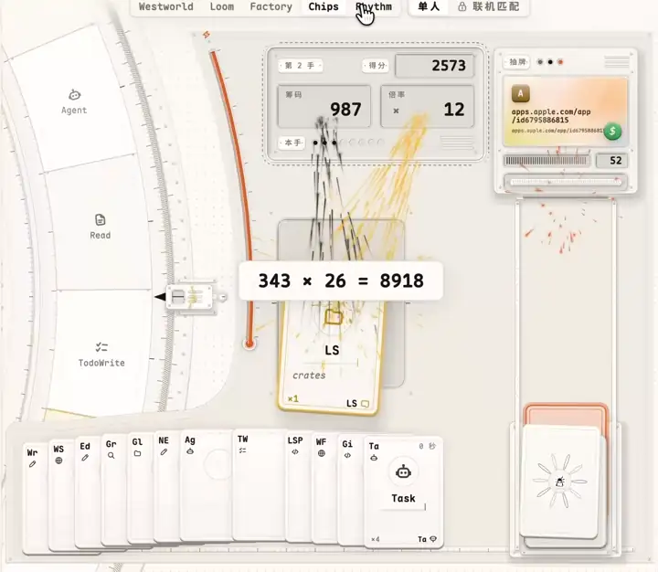
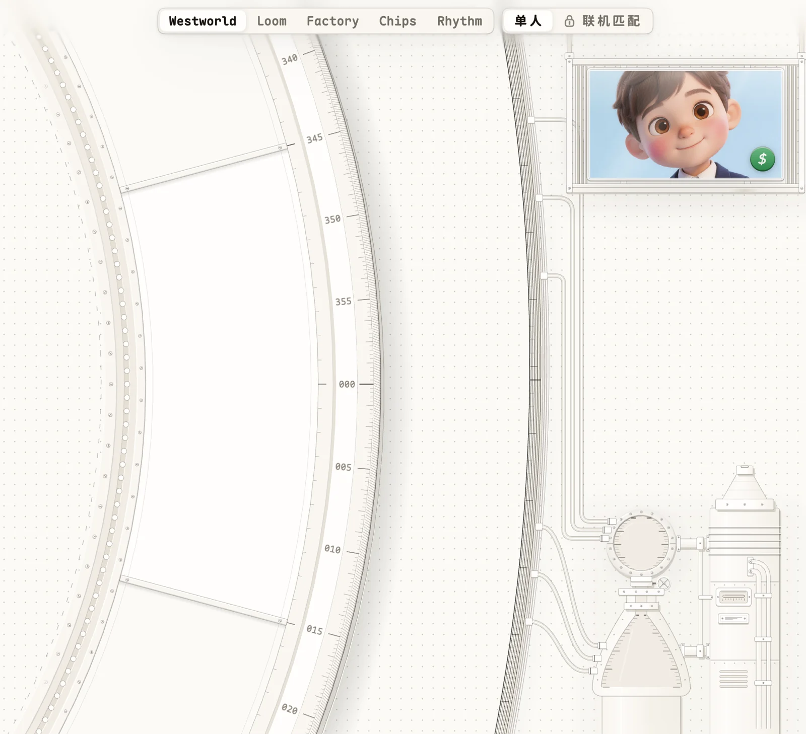
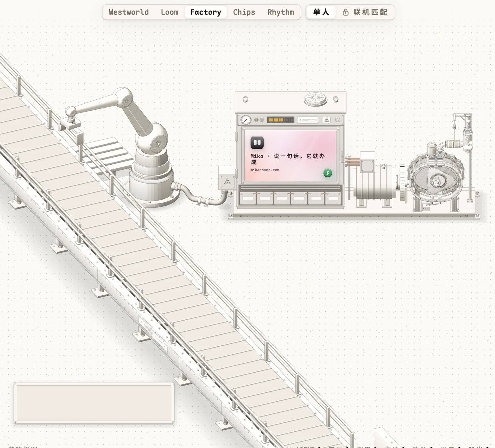
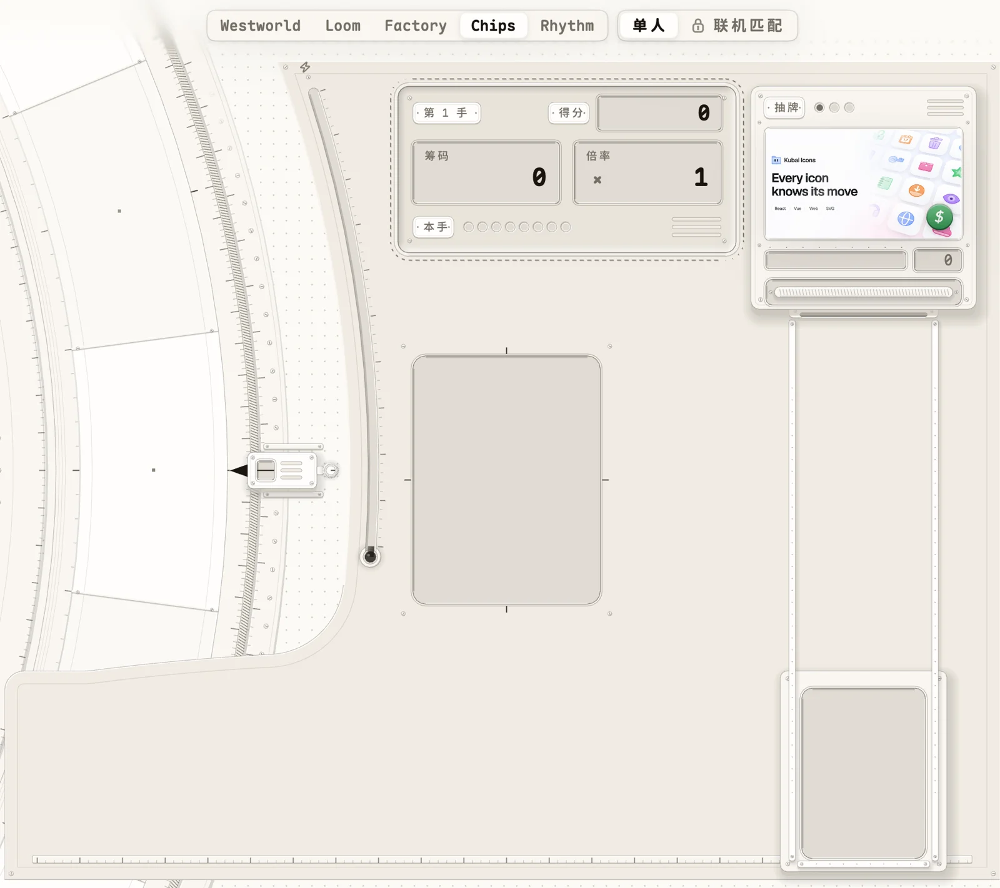
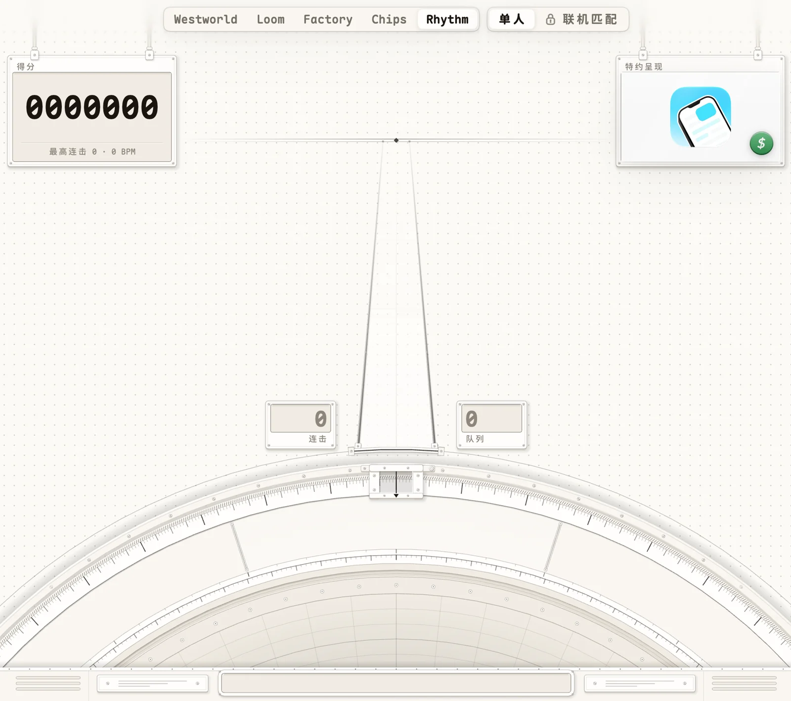

<p align="center">
  <a href="https://cromma.ai/code">
    
  </a>
</p>

<h1 align="center">CrommaCode</h1>

<p align="center">
  <b>The gamified IDE for coding agents. Watch your agent work. Send a swarm when one is not enough.</b><br>
  <sub>游戏化的 AI 编程桌面：旁观你的 agent 干活，一只不够就派一群。</sub>
</p>

<p align="center">
  <a href="https://cromma.ai/code"><b>Website</b></a> ·
  <a href="#download">Download</a> ·
  <a href="#the-idea">The idea</a> ·
  <a href="#game-view">Game View</a> ·
  <a href="#the-swarm">The swarm</a> ·
  <a href="#architecture">Architecture</a> ·
  <a href="#faq">FAQ</a> ·
  <a href="README.zh-CN.md">简体中文</a>
</p>

<p align="center">
  
  
  
  
  <br>
  
  
  
  
</p>

---

CrommaCode is a native, GPU-drawn desktop app for coding agents. You run your own coding CLI in its terminal: Claude Code, Codex, Gemini CLI, Cursor CLI or OpenCode. CrommaCode watches every tool call the agent makes and plays the session back as a game beside the terminal. When a task is wide, the agent splits it and sends worker bees: headless agents, each in its own git worktree and branch, on the model provider you pick.

It is free. It runs on macOS, Windows and Linux.

<p align="center">
  <a href="assets/game-view-demo.mp4">
    
  </a>
  <br>
  <sub>Game View during a real session. Click for the full-quality video.</sub>
</p>

> This repository is the public home of CrommaCode: what it is, how it is built and where to get it. It holds no source code. The app is developed in a private monorepo.

## Contents

- [Download](#download)
- [The idea](#the-idea)
- [What it does](#what-it-does)
- [Game View](#game-view)
- [The swarm](#the-swarm)
- [Architecture](#architecture)
- [Tech stack](#tech-stack)
- [Updates](#updates)
- [Privacy](#privacy)
- [FAQ](#faq)
- [Links](#links)

## Download

Get it at **[cromma.ai/code](https://cromma.ai/code)**, or straight from the release bucket. The links always point at the latest stable version.

| Platform | Download |
| --- | --- |
| macOS 13+, Apple Silicon | [CrommaCode-macos-arm64.dmg](https://dl.cromma.ai/code/stable/CrommaCode-macos-arm64.dmg) |
| macOS 13+, Intel | [CrommaCode-macos-x64.dmg](https://dl.cromma.ai/code/stable/CrommaCode-macos-x64.dmg) |
| Windows 10+, x64 | [CrommaCode-windows-x64-setup.exe](https://dl.cromma.ai/code/stable/CrommaCode-windows-x64-setup.exe) |
| Linux x86_64, any distro (glibc 2.35+) | [CrommaCode-linux-x86_64.AppImage](https://dl.cromma.ai/code/stable/CrommaCode-linux-x86_64.AppImage) |
| Debian, Ubuntu | [CrommaCode-linux-amd64.deb](https://dl.cromma.ai/code/stable/CrommaCode-linux-amd64.deb) |

- The two macOS disk images are notarized by Apple. Pick the one for your chip: the Apple Silicon build does not open on an Intel Mac.
- The Windows installer needs no administrator rights and installs per user.
- The current version and its checksums are in [`latest.json`](https://dl.cromma.ai/code/stable/latest.json).

## The idea

A coding agent in a terminal is a wall of scrolling text. You cannot tell at a glance what it is doing, how hard it is working or whether it is stuck. So you either stare at the log or you stop looking.

CrommaCode makes the agent's work **watchable**.

1. **The game is a side channel.** Your CLI stays exactly as it is. A tool hook reports every call the agent and its sub-agents make. CrommaCode turns that stream into a show next to the terminal. Nothing is injected into the agent's context and nothing slows it down.
2. **Every call lands exactly once.** Reads, edits, shell commands, searches and sub-agent launches each become one beat. Parallel sub-agents never blur together: the show plays calls in order, folds repeats into ×N and shows the backlog.
3. **One agent is a game. Many agents are a swarm.** When a task is wide, the main agent writes briefs and flies worker bees. You watch them leave the hive, work a flower bed and land.
4. **The machine is the explanation.** Each view is a precise, machined instrument whose motion is the agent's activity. A dial turns to the tool in use. A loom weaves a row per call. A belt carries a box per call. You read the session the way you read a gauge.

## What it does

- **Terminals.** One sidebar for projects, their terminals and files. The selected terminal floats as a resizable frosted-glass card over the dashboard.
- **Two faces per terminal.** The TUI face is your own CLI, untouched. The GUI face is a separate Agent Client Protocol (ACP) session with structured messages, tool cards and permission buttons. Flip with <kbd>⇧⌘J</kbd>.
- **Game View.** The main agent at work, in five modes.
- **Bees.** Worker bees fly from the hive to the garden on a pixel meadow. Each bee lands only when it finishes.
- **Files.** A fuzzy file finder and a read-only reader with tree-sitter highlighting, Markdown rendering, images, tables and a hex view.
- **Git.** A read-only history drawn as a metro map, staged and unstaged changes with diffs, and a branch switcher.
- **Traces.** What shaped this session: instruction files, images, memories, plans, visits, artifacts and sub-agents.
- **Stats.** Token use across every coding CLI on this machine, by week, month and year. It never leaves the machine.
- **Ranks.** The developer leaderboard as an endless plane of seats, and the sponsor boards of Game View.

## Game View

Five ways to watch the same session. Switch at any time.

| Mode | What you see |
| --- | --- |
| **Westworld** | A lab instrument. A huge dial turns to the tool in use. Each tool owns a slot with its count, trend and latest parameters. Pipes inside the dial carry a pulse to each file the agent touches. Energy charges two tanks until a laser fires. |
| **Loom** | A tapestry. Each call throws a shuttle and weaves a row whose pattern comes from the call. A Jacquard controller punches one card per row. Portraits appear in the cloth as the session goes on. |
| **Factory** | A parcel line. Each call is a box a six-axis robot arm lifts off the pallet and sets on the belt. Heavier thinking makes bigger boxes. Every box bursts at the end of the line. |
| **Chips** | A card table. Each tool is a card in your hand. Every call plays its card and scores chips times mult. A hand settles when the queue drains. |
| **Rhythm** | A rhythm game. Each tool gets a lane. Calls fly down as notes and hit the judgment bar for PERFECT, GREAT or GOOD, a combo and a score. |

<table>
  <tr>
    <td width="50%"><br><sub><b>Westworld</b></sub></td>
    <td width="50%"><br><sub><b>Factory</b></sub></td>
  </tr>
  <tr>
    <td width="50%"><br><sub><b>Chips</b></sub></td>
    <td width="50%"><br><sub><b>Rhythm</b></sub></td>
  </tr>
</table>

Nothing to set up. When a coding CLI starts in a CrommaCode terminal, Game View recognizes it and adds its tool hook to that CLI's user settings, keeping a backup. Codex runs only reviewed hooks: run `/hooks` in Codex once and trust the hook.

Game View also has sound: live-synthesized music that follows the session's intensity and one hit per tool. Both have a switch.

## The swarm

Open **Settings → Bees**, pick a model provider and paste its key. Then tell your CLI in plain words to use the swarm. The main agent plans, writes one brief per bee, launches them, merges their branches and verifies.

- Each bee is a headless coding agent in its own git worktree and branch.
- Providers that speak Anthropic Messages are reached directly. Providers that speak OpenAI Chat or Responses go through a local gateway on `127.0.0.1`. Your real key never leaves that process.
- The provider list is a priority list. If the first provider has no key, no balance or no such model, the swarm falls back to the next one and records why.

You can also fly bees by hand:

```sh
bees fly <name> <brief.md>     # fly one bee and wait for it to land
bees swarm <dir>               # fly every brief in <dir> in parallel
bees merge <name>...           # merge bee branches with --no-ff
bees status                    # this terminal's hive
```

## Architecture

```
        your coding CLI in a CrommaCode terminal
   Claude Code · Codex · Gemini CLI · Cursor CLI · OpenCode
        │                                   │
        │ tool hook: one line per call      │ `bees` command
        ▼                                   ▼
  ┌───────────────┐                 ┌─────────────────────┐
  │  the hive     │◄── landings ────│  worker bees        │
  │  one folder   │                 │  headless agents,   │
  │  per terminal │                 │  one git worktree   │
  └───────┬───────┘                 │  and branch each    │
          │ watched, de-duplicated  └──────────┬──────────┘
          ▼                                    │ model calls
  ┌───────────────────────────────┐            ▼
  │  CrommaCode (one GPU window)  │   ┌────────────────────┐
  │  Game View · Bees meadow      │   │ local gateway      │
  │  Files · Git · Traces · Ranks │   │ 127.0.0.1 only     │
  │  terminal card: TUI ⇄ GUI     │   │ Anthropic Messages │
  └───────────────────────────────┘   │ ⇄ OpenAI Chat /    │
                                      │   Responses        │
                                      └─────────┬──────────┘
                                                ▼
                                       your model provider
```

- **The hive is the only seam.** The CLI side writes plain files into one folder per terminal. The app only reads them. The game cannot change what the agent does.
- **Both faces drive the same game.** Calls from the GUI face (ACP) are translated into the same trace as hook calls, so Game View does not care which face you use.
- **Layers point one way.** The app depends on the world model, which depends on the swarm engine, which depends on the gateway. The swarm engine and the gateway have no UI.
- **One window, drawn on the GPU.** Every instrument is a triangle mesh, cached by key and repainted only when something moves. An idle view costs zero frames.
- **Platform differences live at compile time.** macOS renders with Metal, Windows with DirectX 11 and Linux with Vulkan. The interface is the same on all three.

## Tech stack

| Layer | Technology |
| --- | --- |
| Language | Rust 1.98 |
| UI | GPUI, a GPU-accelerated UI framework, with our own patches: smooth squircle corners, backdrop blur and glass, GPU triangle meshes, GPU particles |
| Renderers | Metal (macOS) · DirectX 11 (Windows) · Vulkan (Linux) |
| Terminal | alacritty_terminal |
| Syntax | tree-sitter, 42 grammars |
| Markdown | pulldown-cmark |
| Agents | Tool hooks for five coding CLIs · Agent Client Protocol (ACP) for the GUI face |
| Model gateway | Local translation between Anthropic Messages and OpenAI Chat or Responses, streamed |
| Sound | A real-time synth with no samples: music in layers and one hit per tool |
| Updates | A public manifest and minisign signatures; notarized DMGs on macOS |
| Languages | English · 简体中文 · 日本語 |

## Updates

Installed copies read a public manifest at `https://dl.cromma.ai/code/stable/latest.json` every 15 minutes. No account or token is needed. Every download is verified against a minisign public key built into the app.

- **macOS:** the new app is swapped in atomically. If it fails to start, the old one is put back.
- **Windows:** the verified installer runs and reopens the app.
- **AppImage:** the file replaces itself.
- **deb:** the download opens in your browser.

## Privacy

- **Stays on your machine:** prompts, replies, file paths, code, traces and the token ledger. All local state lives in `~/.cromma-bees`. Set `BEES_HOME` to move it.
- **Your provider keys** are stored locally and go only to the provider you chose, or to the gateway on `127.0.0.1`.
- **Signed in:** CrommaCode uploads hourly token totals for the leaderboard. Nothing else from your sessions. Signing in is optional.
- **Install count:** the app sends one anonymous ping per day: version, system, screen size, language and country. It is not linked to an account and stores no IP address.
- **Sponsor boards** in Game View are fetched from a public endpoint. They carry no data about you.

## FAQ

**Does it replace my coding CLI?**
No. You keep using Claude Code, Codex, Gemini CLI, Cursor CLI or OpenCode. CrommaCode is the desktop around it.

**Does Game View slow the agent down or use tokens?**
No. The hook writes one line per tool call to a local file. Nothing goes into the agent's context.

**Do I need an account?**
No. An account is only for the leaderboard.

**Do I need the swarm?**
No. Game View works with a single agent. The swarm is for wide tasks.

**Which models can bees use?**
Any provider you configure in Settings → Bees. Anthropic-compatible providers are reached directly and OpenAI-compatible providers go through the local gateway.

**Is it open source?**
Not yet. This repository is the public home for the idea, the architecture and the downloads.

**Where do I report a bug or suggest something?**
Open an issue here, or use the suggestion box inside the app (the Evolve button in the sidebar).

## Links

- Website and downloads: [cromma.ai/code](https://cromma.ai/code)
- Author on X: [@chunxiangai](https://x.com/chunxiangai)
- Cromma: [cromma.ai](https://cromma.ai)

---

<sub>© Cromma. CrommaCode and the CrommaCode mark are trademarks of Cromma. See [LICENSE](LICENSE). Claude Code, Codex, Gemini CLI, Cursor and OpenCode are products of their respective owners; CrommaCode is not affiliated with them.</sub>
