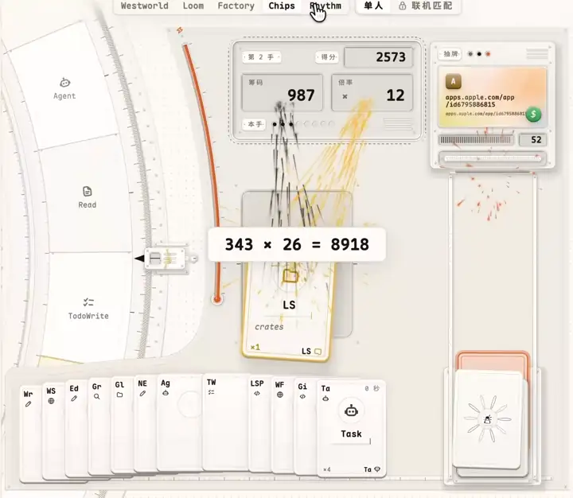
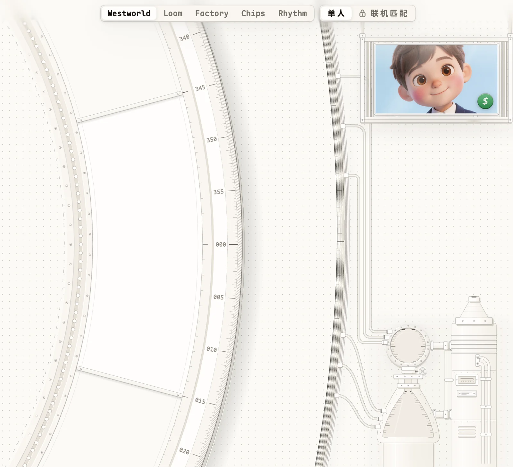
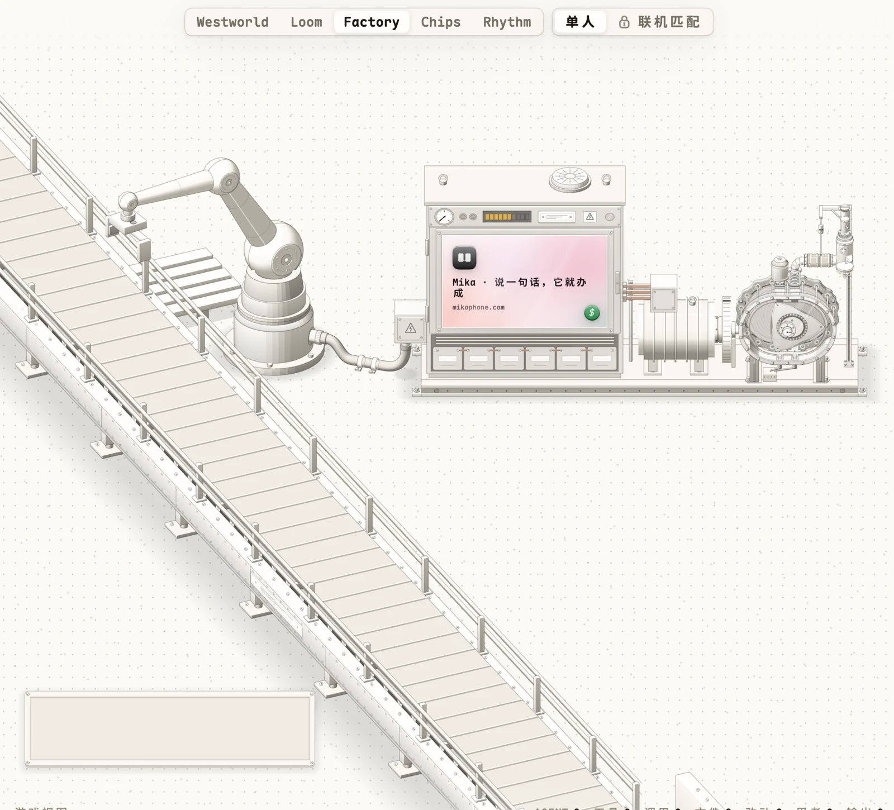
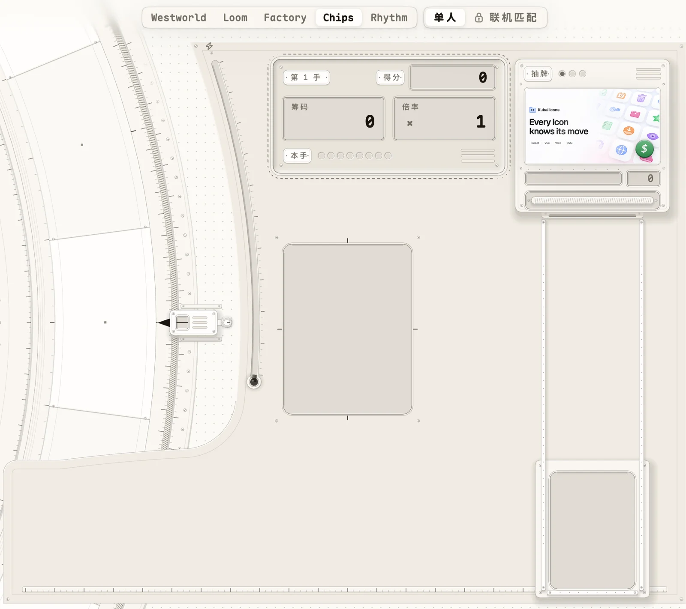
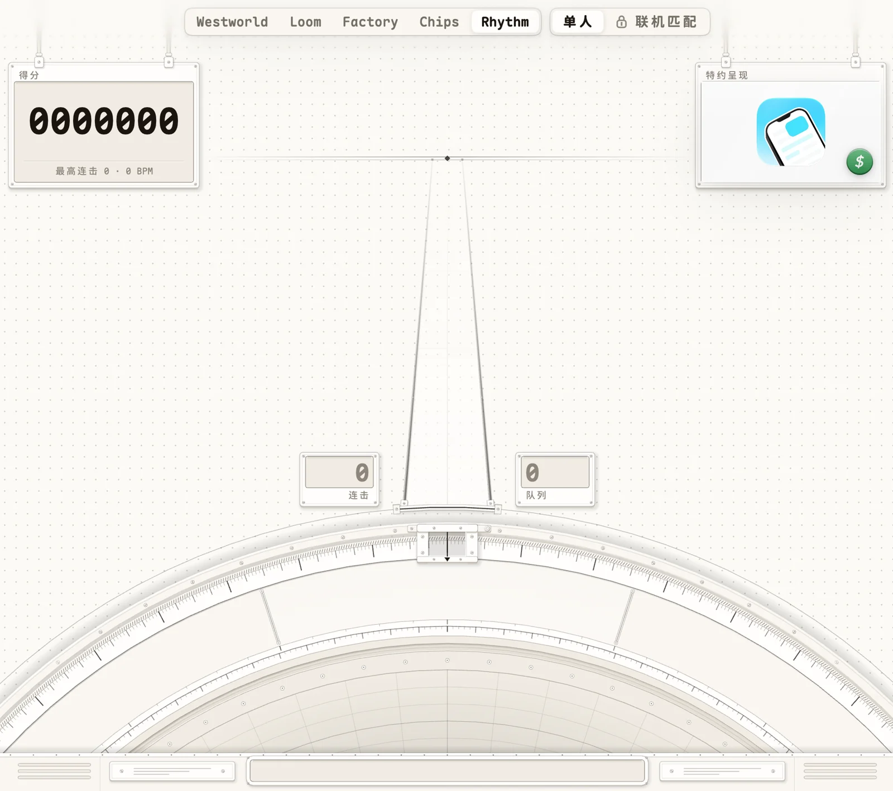

<p align="center">
  <a href="https://cromma.ai/code">
    
  </a>
</p>

<h1 align="center">CrommaCode</h1>

<p align="center">
  <b>游戏化的 AI 编程桌面。旁观你的 agent 干活，一只不够就派一群。</b><br>
  <sub>The gamified IDE for coding agents.</sub>
</p>

<p align="center">
  <a href="https://cromma.ai/code"><b>官网</b></a> ·
  <a href="#下载">下载</a> ·
  <a href="#理念">理念</a> ·
  <a href="#game-view">Game View</a> ·
  <a href="#蜂群">蜂群</a> ·
  <a href="#架构">架构</a> ·
  <a href="#常见问题">常见问题</a> ·
  <a href="README.md">English</a>
</p>

<p align="center">
  
  
  
  
  <br>
  
  
  
</p>

---

CrommaCode 是给编程 agent 用的原生桌面应用，整窗由 GPU 直绘。你在它的终端里跑自己的编程 CLI：Claude Code、Codex、Gemini CLI、Cursor CLI 或 OpenCode。CrommaCode 看着 agent 的每一次工具调用，在终端旁边把这场会话演成一场游戏。任务太宽时，agent 把它拆开、派出工蜂：每只蜂是一个无界面的 agent，在自己的 git worktree 与分支里干活，跑在你选的模型供应商上。

免费。支持 macOS、Windows 与 Linux。

<p align="center">
  <a href="assets/game-view-demo.mp4">
    
  </a>
  <br>
  <sub>一场真实会话里的 Game View。点开看原画质视频。</sub>
</p>

> 这个仓库是 CrommaCode 的公开门面：它是什么、怎么搭的、去哪里下载。这里不放源码，应用在私有单仓里开发。

## 目录

- [下载](#下载)
- [理念](#理念)
- [能做什么](#能做什么)
- [Game View](#game-view)
- [蜂群](#蜂群)
- [架构](#架构)
- [技术栈](#技术栈)
- [自更新](#自更新)
- [隐私](#隐私)
- [常见问题](#常见问题)
- [链接](#链接)

## 下载

到 **[cromma.ai/code](https://cromma.ai/code)** 下载，或直接取发布桶里的包。下面的链接恒指向最新稳定版。

| 平台 | 下载 |
| --- | --- |
| macOS 13+，Apple 芯片 | [CrommaCode-macos-arm64.dmg](https://dl.cromma.ai/code/stable/CrommaCode-macos-arm64.dmg) |
| macOS 13+，Intel | [CrommaCode-macos-x64.dmg](https://dl.cromma.ai/code/stable/CrommaCode-macos-x64.dmg) |
| Windows 10+，x64 | [CrommaCode-windows-x64-setup.exe](https://dl.cromma.ai/code/stable/CrommaCode-windows-x64-setup.exe) |
| Linux x86_64，任意发行版（glibc 2.35+） | [CrommaCode-linux-x86_64.AppImage](https://dl.cromma.ai/code/stable/CrommaCode-linux-x86_64.AppImage) |
| Debian、Ubuntu | [CrommaCode-linux-amd64.deb](https://dl.cromma.ai/code/stable/CrommaCode-linux-amd64.deb) |

- 两个 macOS 磁盘映像都经过 Apple 公证。按芯片选包：Apple 芯片的包在 Intel Mac 上打不开。
- Windows 安装包不要管理员权限，按用户安装。
- 当前版本号与校验值在 [`latest.json`](https://dl.cromma.ai/code/stable/latest.json)。

## 理念

终端里的编程 agent 是一面滚动的字墙。你一眼看不出它在干什么、有多卖力、是不是卡住了。于是你要么盯着日志，要么干脆不看。

CrommaCode 让 agent 的工作**看得见**。

1. **游戏是旁路。** 你的 CLI 原样不动。一个工具钩子把 agent 与它的子 agent 的每次调用报出来，CrommaCode 把这条流在终端旁边演成一场戏。不往 agent 的上下文里塞任何东西，也不拖慢它。
2. **每次调用恰好落一次。** 读、改、命令行、搜索、派子 agent，各是一拍。并行的子 agent 不会糊成一团：演出按次序放，重复的并成 ×N，积压看得见。
3. **一个 agent 是一场游戏，许多 agent 是一群蜂。** 任务宽时，主 agent 写任务书、放飞工蜂。你看着它们离巢、在花圃上干活、归巢。
4. **机器即解释。** 每个视图都是一台精密的机加工仪器，它的运动就是 agent 的活动。转盘转到正在用的工具，织机每次调用织一行，皮带每次调用送一只箱子。你像读仪表一样读这场会话。

## 能做什么

- **终端。** 一条侧栏管项目、终端与文件。选中的终端浮成一张可缩放的磨砂玻璃卡，压在 dashboard 上。
- **一张卡两面。** TUI 面原样是你自己的 CLI。GUI 面是一个独立的 Agent Client Protocol（ACP）会话，画结构化的消息、工具卡与权限钮。<kbd>⇧⌘J</kbd> 翻面。
- **Game View。** 主 agent 的运作屏，五种模式。
- **Bees。** 工蜂在像素草地上从蜂巢飞向花圃，干完才落地。
- **文件。** 模糊找文件，只读阅读器带 tree-sitter 高亮、Markdown 渲染、图片、表格与十六进制视图。
- **Git。** 只读的历史画成地铁图，改动带 diff，可切分支。
- **痕迹。** 是什么塑造了这场会话：指令文件、图片、记忆、计划、访问、产物与子 agent。
- **统计。** 本机全部编程 CLI 的 token 用量，按周、月、年。数据不离开本机。
- **排行榜。** 开发者榜是一架接一架的飞机座舱，另有 Game View 的冠名品牌榜。

## Game View

同一场会话，五种看法，随时切换。

| 模式 | 你看到的 |
| --- | --- |
| **Westworld** | 一台实验室仪器。巨盘转到正在用的工具，每个工具一格，写着次数、走势与最近的参数。盘里的管网把脉冲送到 agent 碰过的每个文件。能量给两只罐充能，充满即开一道激光。 |
| **Loom** | 一幅挂毯。每次调用投一梭、织一行，花样由调用决定。提花控制机每行打一张卡。肖像随会话在布上织出来。 |
| **Factory** | 一条包裹流水线。每次调用是一只箱子，六轴机械臂把它从托盘搬上皮带。想得越多箱子越大，走到尽头爆开。 |
| **Chips** | 一张牌桌。每个工具是手里的一张牌，每次调用打出它的牌，筹码乘倍率计分。队列放空即结算一手。 |
| **Rhythm** | 一场节奏游戏。每个工具一条轨，调用像音符飞下来，打在判定梁上：PERFECT、GREAT 或 GOOD，连击与得分。 |

<table>
  <tr>
    <td width="50%"><br><sub><b>Westworld</b></sub></td>
    <td width="50%"><br><sub><b>Factory</b></sub></td>
  </tr>
  <tr>
    <td width="50%"><br><sub><b>Chips</b></sub></td>
    <td width="50%"><br><sub><b>Rhythm</b></sub></td>
  </tr>
</table>

不用配置。编程 CLI 在 CrommaCode 的终端里一启动，Game View 就认出它，把工具钩子加进那一家 CLI 的用户设置，并留备份。Codex 只跑审过的钩子：在 Codex 里跑一次 `/hooks` 并信任它。

Game View 有声音：实时合成的音乐随会话的强度起伏，每个工具一记打击。两样都有开关。

## 蜂群

打开**设置 → Bees**，选一家模型供应商、贴上密钥。然后用大白话对你的 CLI 说「用蜂群」。主 agent 负责规划、给每只蜂写任务书、放飞、合并分支并验收。

- 每只蜂是一个无界面的编程 agent，在自己的 git worktree 与分支里干活。
- 说 Anthropic Messages 的供应商直连。说 OpenAI Chat 或 Responses 的，经本机 `127.0.0.1` 上的网关翻译。真密钥不出那个进程。
- 供应商列表的次序即优先级。第一家没密钥、没余额或没有那个模型，蜂群回落到下一家，并记下原因。

也可以手动放蜂：

```sh
bees fly <name> <brief.md>     # 放一只蜂，等它落地
bees swarm <dir>               # 把 <dir> 里的任务书全部并行放飞
bees merge <name>...           # 以 --no-ff 合并蜂的分支
bees status                    # 这个终端的蜂箱
```

## 架构

```
          CrommaCode 终端里你自己的编程 CLI
   Claude Code · Codex · Gemini CLI · Cursor CLI · OpenCode
        │                                   │
        │ 工具钩子：每次调用一行            │ `bees` 命令
        ▼                                   ▼
  ┌───────────────┐                 ┌─────────────────────┐
  │  蜂箱         │◄──── 归巢 ──────│  工蜂               │
  │  每个终端     │                 │  无界面的 agent，   │
  │  一个目录     │                 │  各占一个 worktree  │
  └───────┬───────┘                 │  与一条分支         │
          │ 监视、去重              └──────────┬──────────┘
          ▼                                    │ 模型请求
  ┌───────────────────────────────┐            ▼
  │  CrommaCode（一扇 GPU 窗口）  │   ┌────────────────────┐
  │  Game View · 蜂群草地         │   │ 本机网关           │
  │  文件 · Git · 痕迹 · 排行榜   │   │ 只听 127.0.0.1     │
  │  终端卡：TUI ⇄ GUI            │   │ Anthropic Messages │
  └───────────────────────────────┘   │ ⇄ OpenAI Chat /    │
                                      │   Responses        │
                                      └─────────┬──────────┘
                                                ▼
                                         你的模型供应商
```

- **蜂箱是唯一的接缝。** CLI 一侧往每个终端的目录里写普通文件，应用只读它们。游戏改变不了 agent 做什么。
- **两面驱动同一场游戏。** GUI 面（ACP）的调用被译成与钩子同一种记录，Game View 不分你用的是哪一面。
- **层只朝一个方向依赖。** 应用依赖世界模型，世界模型依赖蜂群内核，蜂群内核依赖网关。蜂群内核与网关没有界面。
- **一扇窗，GPU 直绘。** 每台仪器都是一张三角网，按键缓存，只在有东西动时重画。静止的视图零帧。
- **平台差异写在编译期。** macOS 走 Metal，Windows 走 DirectX 11，Linux 走 Vulkan，三个平台同一套界面。

## 技术栈

| 层 | 技术 |
| --- | --- |
| 语言 | Rust 1.98 |
| 界面 | GPUI（GPU 加速的界面框架），带我们自己的补丁：超椭圆平滑圆角、backdrop 模糊与玻璃、GPU 三角网、GPU 粒子 |
| 渲染器 | Metal（macOS）· DirectX 11（Windows）· Vulkan（Linux） |
| 终端 | alacritty_terminal |
| 语法高亮 | tree-sitter，42 种文法 |
| Markdown | pulldown-cmark |
| Agent | 五家编程 CLI 的工具钩子 · GUI 面走 Agent Client Protocol（ACP） |
| 模型网关 | 本机在 Anthropic Messages 与 OpenAI Chat、Responses 之间流式互译 |
| 声音 | 不带采样的实时合成器：分层的音乐，每个工具一记打击 |
| 更新 | 公开清单加 minisign 签名；macOS 的 DMG 经公证 |
| 语言 | English · 简体中文 · 日本語 |

## 自更新

装好的应用每 15 分钟读一次公开清单 `https://dl.cromma.ai/code/stable/latest.json`，不要账号或令牌。每次下载都用内嵌的 minisign 公钥验签。

- **macOS：** 原子换入新包，启动失败即换回旧包。
- **Windows：** 运行验过签的安装包并重开应用。
- **AppImage：** 文件原地换成新版。
- **deb：** 在浏览器里打开下载。

## 隐私

- **留在本机的：** 提示词、回复、文件路径、代码、痕迹与 token 账本。全部本地状态在 `~/.cromma-bees`，设 `BEES_HOME` 可改位置。
- **供应商密钥**存在本机，只发给你选的那家供应商，或 `127.0.0.1` 上的网关。
- **登录后：** 只上传每小时的 token 聚合，供排行榜用。会话里的别的东西都不上传。登录是可选的。
- **装机统计：** 应用每天发一个匿名的包：版本、系统、屏幕尺寸、语言与国家。它不连账号，不存 IP。
- **冠名榜**从公开接口读取，不带你的任何数据。

## 常见问题

**它取代我的编程 CLI 吗？**
不。你照旧用 Claude Code、Codex、Gemini CLI、Cursor CLI 或 OpenCode。CrommaCode 是围着它的桌面。

**Game View 会拖慢 agent 或多耗 token 吗？**
不会。钩子每次工具调用往本机文件里写一行，不进 agent 的上下文。

**要注册账号吗？**
不用。账号只为上排行榜。

**一定要用蜂群吗？**
不用。Game View 一个 agent 就能看。蜂群是给宽任务用的。

**工蜂能用哪些模型？**
你在设置 → Bees 里配的任何供应商。Anthropic 兼容的直连，OpenAI 兼容的经本机网关。

**开源吗？**
暂时不开源。这个仓库是理念、架构与下载的公开门面。

**去哪里报 bug、提建议？**
在这里开 issue，或用应用里的意见箱（侧栏的「进化」钮）。

## 链接

- 官网与下载：[cromma.ai/code](https://cromma.ai/code)
- 作者的 X：[@chunxiangai](https://x.com/chunxiangai)
- Cromma：[cromma.ai](https://cromma.ai)

---

<sub>© Cromma。CrommaCode 及其标识是 Cromma 的商标，见 [LICENSE](LICENSE)。Claude Code、Codex、Gemini CLI、Cursor 与 OpenCode 归各自所有者，CrommaCode 与它们没有隶属关系。</sub>
